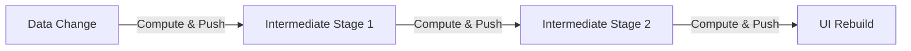
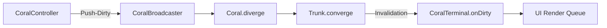
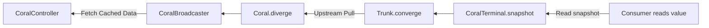

# Coralline Ecosystem

[](https://pub.dev/packages/coralline)
[](https://pub.dev/packages/coralline_extensions)
[](https://pub.dev/packages/coralline_flutter)
[](LICENSE)
[](https://flutter.dev)
[](https://dart.dev)

> *Compose reactive state as a pipeline of connected values.*

**Coralline** is a Dart and Flutter state management library based on reactive pipelines. Its core separates invalidation from reading derived values: upstream changes notify dependent nodes, and derived values are evaluated when read. The project describes this model as **Push-Dirty, Pull-Data**; the Flutter package connects it to widgets, while the core package has no Flutter dependency.

<br>

---

## Packages in this Repository

| Package | pub.dev | Description |
| :--- | :--- | :--- |
| [**`coralline`**](coralline/) | [](https://pub.dev/packages/coralline) | Pure Dart core engine implementing the Chain of Reactivity and Lazy Computation pipeline architecture. |
| [**`coralline_extensions`**](coralline_extensions/) | [](https://pub.dev/packages/coralline_extensions) | Official extension library for reactive pipeline operations on Dart collections and iterables. |
| [**`coralline_flutter`**](coralline_flutter/) | [](https://pub.dev/packages/coralline_flutter) | Flutter widgets and integrations for using Coralline pipelines in an application. |

<br>

---

## Why Coralline?

In Coralline, a source update invalidates dependent pipeline values. The framework propagates change notifications separately from reading and computing derived values. This is one approach to reactive state; behavior and performance differ across libraries and workloads.



**Coralline** decouples dirty notification from data computation into two distinct phases:

### Phase 1: Push-Dirty (COR: Chain of Reactivity)

*(This stage notifies dependent nodes; it does not evaluate and push each derived data payload.)*

### Phase 2: Pull-Data (AL: And Lazy-computation)

*(Dirty derived values are evaluated when read and may reuse cached results until invalidated.)*

<br>

---

## Quick Start (Flutter)

Add `coralline_flutter` to your `pubspec.yaml`:

```yaml
dependencies:
  flutter:
    sdk: flutter
  coralline_flutter: ^0.1.6
```

### 1:1 Inline Reactive Widget Example

```dart
import 'package:flutter/material.dart';
import 'package:coralline_flutter/coralline_flutter.dart';

void main() => runApp(CounterApp());

class CounterApp extends StatelessWidget {
  CounterApp({super.key});

  final counterController = CoralController<int>(0);

  @override
  Widget build(BuildContext context) {
    return MaterialApp(
      home: Scaffold(
        appBar: AppBar(title: const Text('Coralline Counter Example')),
        body: Center(
          child: counterController.provider.coral
              .map((count) => Text(
                    'Count: $count',
                    style: const TextStyle(fontSize: 28, fontWeight: FontWeight.bold),
                  ))
              .toWidget(),
        ),
        floatingActionButton: FloatingActionButton(
          onPressed: () => counterController.set(counterController.data + 1),
          child: const Icon(Icons.add),
        ),
      ),
    );
  }
}
```

<br>

---

## Technical Documentation & Manuals

Explore the in-depth documentation in the [`coralline/doc/manual`](coralline/doc/manual) directory:

1. [**Quickstart & Core Concepts Guide**](coralline/doc/manual/01_quickstart_and_concepts.md) — Build your first reactive pipeline in 5 minutes.
2. [**Pipeline & Broadcasting Guide**](coralline/doc/manual/02_pipeline_and_broadcasting.md) — Master 1:N sharing (`CoralBroadcaster`), dynamic topology (`CoralCoupler`), and snapshots.
3. [**Public API Reference Manual**](coralline/doc/manual/03_public_api_reference.md) — Complete catalog of all public Classes, Mixins, and Extensions.
4. [**Flutter & Dart Engineering Whitepaper**](coralline/doc/manual/04_flutter_dart_engineers_whitepaper.md) — Design details for the Push-Dirty, Pull-Data model and topology routing.

<br>

---

## License

Coralline ecosystem libraries are licensed under the [Apache License 2.0](LICENSE).
