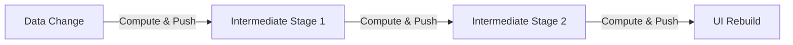
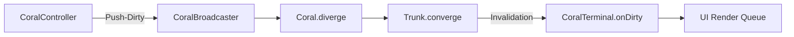
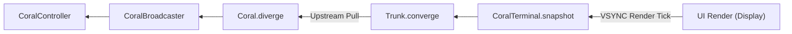
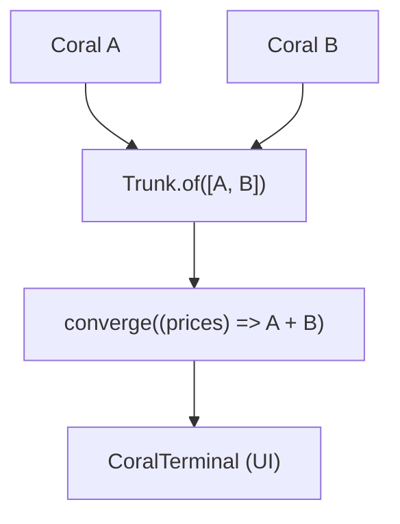
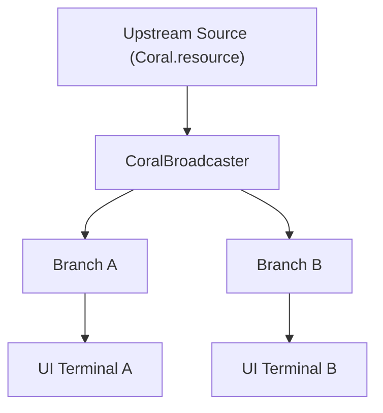
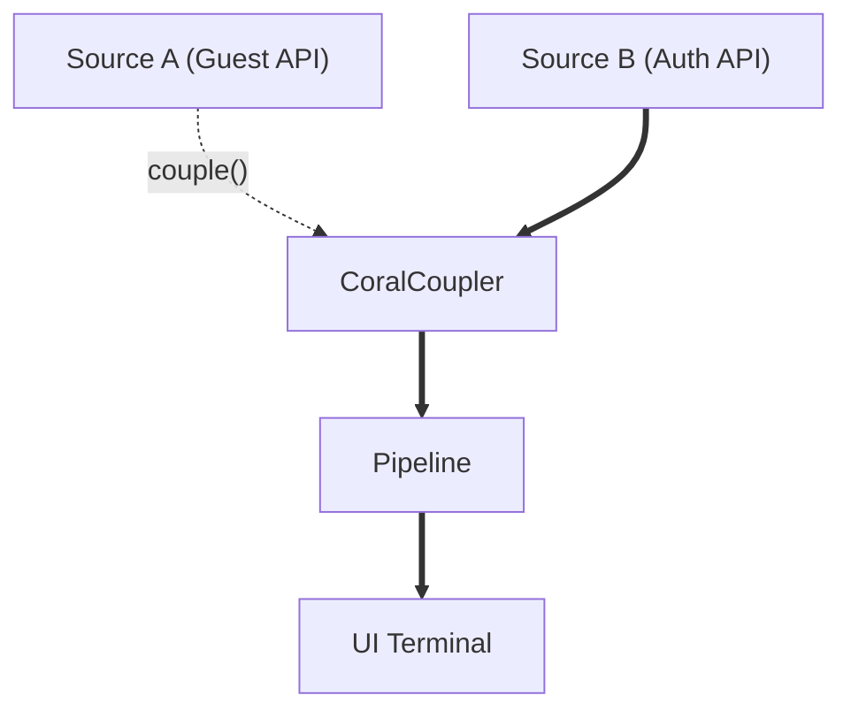

# Coralline

[](https://pub.dev/packages/coralline)
[](LICENSE)
[](https://dart.dev)

> **"Don't write boilerplates. To handle complex reactive pipelines, all you have to do is call a line (Coralline)."**  
> *Stop tangling your logic wires—a composable pipeline for reactive structures. Simply call a line.*

**Coralline** is a Dart reactive pipeline library. Its name for the core model is **CORAL** (**C**hain **o**f **R**eactivity **A**nd **L**azy-computation): source changes invalidate dependent values, while derived values are read and computed on demand. The core package does not depend on Flutter; `coralline_flutter` provides the Flutter integration.

<br><br>

### Why Coralline?

Coralline separates change notification from reading derived values. In this model, an upstream change marks dependent nodes as dirty; reading a value then evaluates the required dirty computations. Other reactive libraries may use different evaluation and notification models.



*(Illustrative eager pipeline: transformations run as values are emitted.)*

<br>

**Coralline** uses this invalidation and on-demand reading model:

#### Phase 1: Push-Dirty (COR: Chain of Reactivity)

*(This stage propagates invalidation; derived payloads are computed when requested.)*

<br>

#### Phase 2: Pull-Data (AL: And Lazy-computation)

*(Reading a terminal value pulls the required data through the pipeline. Flutter decides when its widgets build.)*

1. **Push-Dirty**: A source change invalidates dependent nodes and notifies downstream consumers.
2. **Pull-Data**: Dirty derived values are evaluated when a consumer reads `.snapshot` or `.data` and can be cached until invalidated again.
3. **Topology and fasttrack**: The implementation caches topology information for some graph operations. The cost of an update still depends on the affected graph and the operation; see implementation details before assuming workload-specific complexity.

<br><br>

### Quick Start

#### 1. Counter Pipeline

```dart
import 'package:coralline/coralline.dart';

void main() {
  // 1. Create a reactive controller (Source)
  final controller = CoralController<int>(0);

  // 2. Build a lazy transformation pipeline ("Call a line")
  final doubleCoral = controller.coral.map((count) => count * 2);

  // 3. Connect and activate a terminal (Destination)
  late final CoralTerminal<int> terminal;
  terminal = doubleCoral.toTerminal(() {
    print('Doubled count is: ${terminal.data}');
  });
  terminal.activate();

  // 4. Update data imperatively
  controller.set(1); // Output: Doubled count is: 2
  controller.set(5); // Output: Doubled count is: 10
}
```

#### 2. Async Data & Pattern Matching

```dart
final searchController = CoralController<String>('');

// Async pipeline with cascade and toCoral()
final searchResults = searchController.coral.cascade((query) {
  return fetchSearchResults(query).toCoral();
});

late final CoralTerminal<String> terminal;
terminal = searchResults.toTerminal(() {
  final snapshot = terminal.snapshot;
  if (snapshot.isValid) {
    print('Results: ${snapshot.data}');
  } else if (snapshot.isEmpty) {
    print('Type a search query...');
  } else if (snapshot.isDamaged) {
    print('Error loading results: ${snapshot.error}');
  }
});
terminal.activate();
```

> **Tip: Do I need to write a `switch` statement for every snapshot?**  
> Not at all! For routine UI displays or fallback defaults, ergonomic accessors handle it in a single line:
> - **Fallback Default Value**: `final count = terminal.snapshot.dataOrElse(() => 0);`
> - **Null Operator Convenience**: `final text = terminal.snapshot.dataOrNull?.toString() ?? 'Loading...';`
> - **Direct Access on Guaranteed Sources**: `final data = controller.coral.data;`

<br><br>

### Coralline and Dart Stream

> **Can Coralline replace Dart `Stream`s?** They solve related but different problems. Dart `Stream` is an async event sequence API; Coralline represents state and derived values in a graph. Coralline also provides conversions for working with streams, so the two can be used together.

#### 1. Architecture & Feature Comparison

| Dimension | Dart `Stream` | `Coralline` |
| :--- | :--- | :--- |
| **Primary abstraction** | Async sequence of events | State and derived values represented as a pipeline graph |
| **Evaluation model** | Events are delivered to listeners; operators follow Stream semantics | Changes invalidate dependent values; reads evaluate dirty derived values |
| **Timing** | Asynchronous delivery | Synchronous reads; async sources can be converted with `toCoral()` |
| **State and errors** | Events and stream errors use separate callbacks | `CoralSnapshot` represents valid, empty, and damaged states |
| **Combining sources** | Stream combination APIs | `Trunk` and `combine`/`converge` APIs |
| **Multiple consumers** | Single-subscription or broadcast stream, depending on stream type | `CoralBroadcaster` for multiple downstream branches |
| **Changing a source** | Manage subscriptions to the desired stream | `CoralCoupler` and dynamic pipeline operators |

#### Role Allocation Guide

1. Consider Coralline when you want state, derived values, and multiple inputs expressed as a pipeline graph.
2. Keep using `Stream` where an asynchronous event sequence is the natural abstraction. Convert a stream to a Coralline value with **`.toCoral()`** when you need to derive state from its events.

```dart
// Recommended Pattern: Capture events via Stream, bind to Coralline via .toCoral()
final Stream<Location> rawGpsStream = GpsSensor.stream();

// The stream-backed Coral follows the lifecycle of its active downstream consumers.
final Coral<Location> locationCoral = rawGpsStream.toCoral();

// Derive a display value from each location update.
final Coral<String> displayAddressCoral = locationCoral
    .map((location) => AddressFormatter.format(location));
```

<br><br>

### Core Topologies

Beyond simple 1:1 pipelines, Coralline provides first-class declarative support for complex reactive graph topologies:

#### 1. N:1 Multi-Source Convergence (`Trunk`)
Bundles multiple independent upstream sources into a single computation. The converged value is derived from the connected inputs when read. Dirty results can be cached until an upstream change invalidates them.



#### 2. 1:N Multicast Sharing (`CoralBroadcaster`)
Shares one source among multiple downstream consumers and manages its active connections. Microtask-deferred `lazyDeactivation` can keep the source active across a short disconnect/reconnect gap.



#### 3. Dynamic Runtime Source Swapping (`CoralCoupler`)
Changes the upstream source at runtime using the coupler's cold or hot swap behavior. Downstream consumers can remain attached to the coupler while its source changes.



<br><br>

### Choosing a state management approach

The table below summarizes broad design differences, not package-specific guarantees or benchmark results. Each ecosystem has multiple APIs and usage patterns.

| Comparison area | BLoC (`flutter_bloc`) | Riverpod | Signals libraries | **Coralline** |
| :--- | :--- | :--- | :--- | :--- |
| **Main building blocks** | Events, state, and blocs/cubits | Providers and references | Signals and derived values | Controllers, `Coral` nodes, and terminals |
| **Derived state** | Commonly modeled with state or stream transformations | Commonly modeled with providers | Commonly modeled with computed signals | Modeled with pipeline operators and `Trunk` |
| **Flutter integration** | Flutter widgets and builders | Provider-aware Flutter APIs | Varies by package | `coralline_flutter` widgets and components |
| **Async state** | API depends on chosen BLoC pattern | Provider APIs include async patterns | Varies by package | `CoralSnapshot` and async conversions |
| **Tradeoffs** | Explicit event/state flow; can involve additional types | Flexible provider graph; requires learning provider APIs | Often concise for local reactive state | Pipeline and lifecycle concepts require learning Coralline's graph model |

<br><br>

### Architecture for Flutter & Dart Engineers

Coralline's Flutter package connects reactive pipeline nodes to Flutter widgets. The core package remains independent of Flutter:

- **Pure Dart core**: The core package does not depend on Flutter widgets. Check the package constraints and target toolchain for supported Dart runtimes.
- **Assertions**: Some invariant checks use Dart assertions and are intended for development-time diagnostics. Their presence alone does not establish the release-build performance cost of the whole package.
- **Microtask Lazy Deactivation**: Shared broadcast pipelines can defer deactivation to a microtask. This may reduce stop-start work when connections are replaced quickly; it does not guarantee flicker-free updates.

<br><br>

### Comprehensive Documentation

Explore our detailed manuals tailored for different audiences:

1. [Quickstart & Core Concepts Guide](doc/manual/01_quickstart_and_concepts.md) - Build your first pipeline in 5 minutes.
2. [Pipeline & Broadcasting Guide](doc/manual/02_pipeline_and_broadcasting.md) - Master 1:N sharing (`CoralBroadcaster`), dynamic topology (`CoralCoupler`), and snapshots.
3. [Public API Reference Manual](doc/manual/03_public_api_reference.md) - Overview of the main public classes and extensions.
4. [Flutter & Dart Engineering Whitepaper](doc/manual/04_flutter_dart_engineers_whitepaper.md) - Design and implementation details for the pipeline model.

<br><br>

### License

Coralline is open-source software licensed under the [Apache 2.0 License](LICENSE).  
Copyright 2023-2026 Youngjune Jeon All rights reserved.
