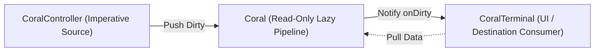

# Coralline Quickstart & Core Concepts Guide

> *Compose reactive state and lazy derivations as a pipeline of connected nodes.*

Coralline is a Dart library for composing reactive pipelines and derived state. Its operators can keep common transformations concise; larger graphs still require choosing and managing their sources and dependencies.

This guide introduces Coralline's three core entities and the **Push-Dirty, Pull-Data** evaluation model.

<br><br>

### 1. The 3 Core Entities

A Coralline pipeline consists of 3 simple entities: **Source $\rightarrow$ Transformation $\rightarrow$ Destination**.



#### 1) `CoralController<T>` (Imperative Source)
- Positioned at the top of the pipeline to inject external data (UI clicks, network responses, WebSockets).
- Conceptually similar to `StreamController`, but does not continuously flood data downstream.
- Broadcasts only a lightweight **"Dirty Flag"** downstream.

#### 2) `Coral<T>` (Declarative Pipeline)
- A strictly **Read-only** reactive node that cannot be modified directly from the outside.
- Composable using operators like `.map()`, `.distinct()`, `.cascade()`, `.diverge()`, `.fallback()`, and `.guard()`.
- Computations stay **Strictly Lazy** until downstream explicitly requests data.

#### 3) `CoralTerminal<T>` (Destination / UI Binding)
- Positioned at the bottom (Terminal) of the pipeline to display or gather data.
- **Parameterless `void Function() onDirty`**: The callback notifies the consumer that the pipeline changed. A consumer can schedule a rebuild and read the value separately. How updates are batched depends on the consumer; the callback alone does not guarantee frame coalescing.
- **Mandatory Teardown (`terminal.deactivate()`)**: Always deactivate terminals inside `dispose()` or cleanup handlers to transition upstream pipeline nodes to the inactive state and release lifecycle-bound resources.

<br><br>

### 2. Core Paradigm: Push-Dirty, Pull-Data & Source Bindings

Some reactive pipelines evaluate transformations as events or state changes are delivered. Coralline instead marks dependent values dirty and evaluates them when read. Which model is preferable depends on the application and the work performed.

Coralline uses a related separation between invalidation and later computation. Flutter has its own rendering and frame scheduling pipeline:

```
[ Phase 1: Push-Dirty ]
controller.set(10) ---> Invalidate downstream _snapshot caches (lightweight notification)

[ Phase 2: Coalescing ]
Subsequent controller.set() calls while a pull is pending (_isPullPending) are coalesced until .snapshot is read

[ Phase 3: Pull-Data ]
UI render cycle calls terminal.snapshot ---> Interrogate container (Valid/Empty/Damaged) & compute lazily
```

#### Synchronous and asynchronous sources

Coralline supports synchronous values and async conversions. Applications can also feed results from work they run elsewhere into a controller:
- **Synchronous In-Memory Binding** (`CoralController(initialData)`, `Coral.data`): Immediately exposes a `Valid` snapshot; controller updates dispatch dirty notifications synchronously (`CoralController.late()` starts `Empty` until its first update).
- **Asynchronous I/O Binding** (`Future.toCoral()`, `Stream.toCoral()`): Async conversions expose results through Coralline snapshots. An empty snapshot can represent a result that is not yet available, while a damaged snapshot carries an error. Applications choose how to handle nullable payloads.
- **Background work**: Coralline does not create or manage Dart isolates. An application can perform work in an isolate and pass the result back through a controller or another source.

<br><br>

### 3. Practical Examples

#### Example 1: Form Field Validation Pipeline

```dart
import 'dart:async';
import 'package:coralline/coralline.dart';

class LoginFormState {
  final emailController = CoralController<String>('');
  final passwordController = CoralController<String>('');

  late final Coral<bool> isEmailValid;
  late final Coral<bool> isPasswordValid;
  late final Coral<bool> isFormValid;

  LoginFormState() {
    isEmailValid = emailController.coral.map((email) => email.contains('@'));
    isPasswordValid = passwordController.coral.map((pw) => pw.length >= 8);
    isFormValid = [isEmailValid, isPasswordValid]
        .toTrunk()
        .aggregate((lines) => lines.every((line) => line.data));
  }
}

void main() {
  final form = LoginFormState();
  late final CoralTerminal<bool> terminal;
  terminal = form.isFormValid.toTerminal(() {
    scheduleMicrotask(() {
      print('Login button enabled: ${terminal.data}');
    });
  });
  terminal.activate();

  form.emailController.set('user@example.com');
  form.passwordController.set('secret1234');
}
```

#### Example 2: Async Search & `CoralSnapshot` State Handling

```dart
import 'dart:async';
import 'package:coralline/coralline.dart';

Future<List<String>> fetchSearchResults(String query) async =>
    ['$query Docs', '$query SDK'];

void main() async {
  final queryController = CoralController<String>('');

  final searchPipeline = queryController.coral.cascade((query) {
    if (query.isEmpty) return Coral.data(<String>[]);
    return fetchSearchResults(query).toCoral();
  });

  late final CoralTerminal<List<String>> terminal;
  terminal = searchPipeline.toTerminal(() {
    scheduleMicrotask(() {
      final snapshot = terminal.snapshot;
      if (snapshot.isValid) {
        print('Search results: ${snapshot.data}');
      } else if (snapshot.isEmpty) {
        print('Loading search results...');
      } else if (snapshot.isDamaged) {
        print('Error loading search: ${snapshot.error}');
      }
    });
  });
  terminal.activate();

  queryController.set('Flutter');
}
```

<br><br>

### 4. Summary & Next Steps

- **CoralController**: Imperative data source
- **Coral**: Read-only lazy pipeline
- **CoralTerminal**: UI/Destination pull point

Next: [Pipeline & Broadcasting Guide](02_pipeline_and_broadcasting.md) to learn about 1:N sharing and dynamic topology (`CoralCoupler`).
