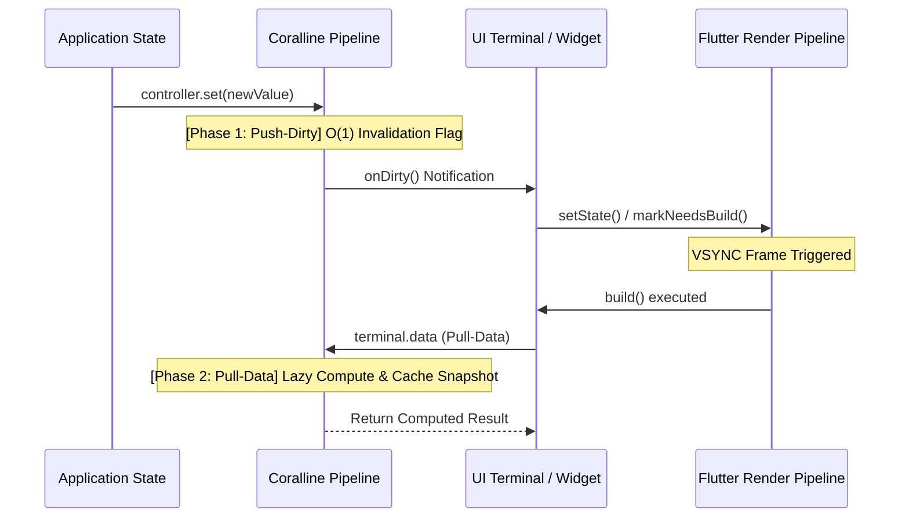
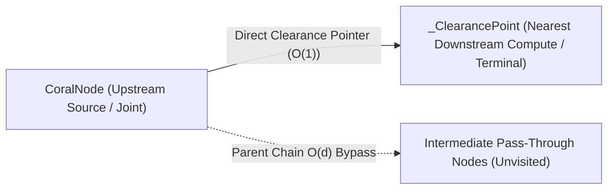
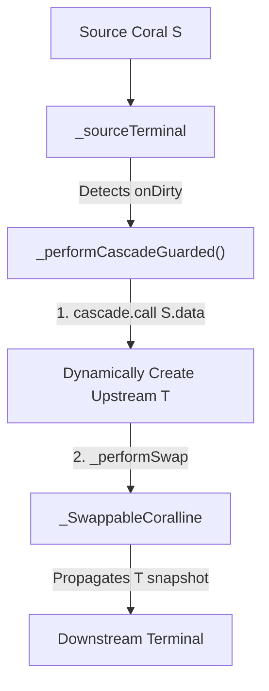

# Engineering Whitepaper for Flutter & Dart Engineers

**Coralline Engine Architecture: Push-Dirty, Pull-Data Reactivity and Fasttrack Routing**

> **Author**: Youngjune Jeon  
> **Target Audience**: Flutter Framework Engineers, Dart VM/Compiler Engineers, Software Architects

<br><br>

### 1. Executive Summary

This document describes the intended design and implementation of Coralline. Complexity and performance statements below refer to specific code paths; they are not comparative benchmark results. End-to-end costs depend on graph shape, operators, and consumer behavior.

Reactive applications can do unnecessary work when every update triggers transformations that a consumer does not need. Evaluation strategies differ across frameworks and operators, so the actual cost should be measured for the workload in question.

**Coralline** uses a **Push-Dirty, Pull-Data** model: updates invalidate dependent nodes, and consumers read derived values as needed. Its fasttrack code caches routing information for selected graph operations. This is conceptually similar to parts of Flutter's invalidation and deferred-work model, but Coralline is not an implementation of Flutter's `RenderObject` pipeline.

<br><br>

### 2. Structural Mirroring with Flutter `RenderObject` Pipeline

Flutter schedules rendering work through its frame pipeline. Coralline can be connected to Flutter widgets, but it does not control frame scheduling or guarantee a frame rate.



#### Architecture Comparison

| Concept | Flutter Render Pipeline (`RenderObject`) | Coralline Pipeline (`CoralNode`) |
| :--- | :--- | :--- |
| **Invalidation Notice** | `markNeedsLayout()` (Flags dirty state only) | `_pushDirty()` (O(1) Snapshot invalidation) |
| **Coalescing Buffer** | Frame Scheduler holds build until VSYNC | Coalescing Phase (`_isDirtyPending` flag) |
| **Compute Execution** | Engine calls `performLayout()` backwards | `Terminal` calls `.data` / `.snapshot` |
| **Execution Frequency**| Scheduled by Flutter's rendering pipeline | Dirty values are computed when read and cached until invalidated |

<br><br>

### 3. Fasttrack $O(1)$ Routing (`_CorallineFasttrack`)

Traditional tree-based reactive engines traverse parent chains recursively during invalidation, causing **$O(d)$** ($d$=tree depth) overhead.

`_CorallineFasttrack` pre-caches clearance points when topology changes. The cached pointer can avoid a parent-chain lookup on the relevant routing path; total update work still depends on the affected graph and downstream notifications.



- `_clearancePoint`: Direct $O(1)$ reference to nearest clearance point.
- **Short-circuit Pruning**: Stops top-down topology rerouting immediately if cached clearance matches previous value.

<br><br>

### 4. Development Assertions and Release Builds

Framework invariant checks (including cycle and ownership checks) are intended to catch invalid graphs during development. Dart assertions are disabled in production modes where assertions are disabled, but that does not mean the entire framework has zero release overhead.

```dart
// Actual internal integrity assertions in Coralline (lib/src/node.dart & _computation.dart)
assert(
  !joint._debugIterateDownstream()._containsIdentical(this),
  'A cyclic attachment was detected: target joint already forwards to this coralNode.',
);

assert(() {
  for (final forward in _debugIterateDownstream()) {
    if (forward is _IntentFirewall) {
      throw CorallineTopologyError(
        'Topology Error: CorallineTerminalIntentAware computation is placed upstream of a CoralBroadcaster.',
      );
    }
  }
  return true;
}());
```

- **Release Build Optimization**: Dart AOT compiler strips `assert` blocks completely in release mode.
- **Pure Dart core**: The core package does not depend on `dart:ui` or `flutter/widgets.dart`. Compilation and performance on a particular Dart target should be verified with that target's toolchain.

<br><br>

### 5. The Signaling vs Data Extraction Paradigm

In event-driven pipelines, listeners may process each delivered event. In Coralline, invalidation and value extraction are separate operations, so a consumer that reads after several updates can skip computing intermediate derived values. The result depends on how updates and reads are scheduled by the application.

Coralline decouples **Signaling** (`onDirty`) from **Data Extraction** (`snapshot` / `data`):
1. **Scheduling**: Flutter schedules widget builds according to its own frame lifecycle; Coralline does not batch arbitrary notifications into a frame.
2. **Pull-Data (`snapshot`)**: A widget can read the snapshot while building. If it reads after multiple source updates, derived values that were never read in between need not be computed for those intermediate states.

#### `ComplexComputation` & Encapsulated State Guards (`Coral.guard`)
Lazy N:1 composite nodes like `ComplexComputation` evaluate upstream dependencies on demand. If an uninitialized upstream node yields an `Empty` snapshot during evaluation, extracting `.data` throws a `CoralSnapshotExtractionException`, mutating an expected `Empty` state into `Damaged`.

To protect downstream nodes architecturally without polluting UI logic with defensive `if-else` guards, Coralline provides **Declarative Encapsulated Guards**:
```dart
abstract base class CustomDataAggregator<T> extends ComplexComputation<T> {
  // 1. Define safety condition
  bool canProceed() => iterateInbound().areAllValid();

  // 2. Encapsulate shield within getter
  @override
  Coral<T> get coral => _guardCoral;
  late final Coral<T> _guardCoral = super.coral.guard(canProceed: canProceed);
}
```

<br><br>

### 6. Dynamic Upstream Line Injection & Structural Swapping Mechanics

`_CascadingCoralline<S, T>` elevates upstream nodes to **Pipeline Injectors (Meta Controllers)** capable of dynamically restructuring downstream DAG topology at runtime.

#### Dynamic Swapping Sequence & Dirty Suppression



To prevent duplicate dirty signal cascades during lazy structural graph mutations, `_LazyCascadingCorallineMixin` (and `_LazyCascadingTrunkMixin`) employs `_suppressedDirtyPushCount`:
- Emits the initial downstream dirty signal when the upstream source marks `_onSourceDirty()` (`_performRelease()`).
- Increments `_suppressedDirtyPushCount` during the deferred `_pull()` evaluation prior to `_performCascadeGuarded()`, suppressing redundant secondary dirty notifications while the consumer is actively pulling data.

<br><br>

### 7. Async sources and application-managed background work

Coralline represents synchronous values and async results in a pipeline. It does not create or manage Dart isolates; an application can supply results from its own background work through a controller:

```
┌────────────────────────────────────────────────────────────────────────────────────────────────┐
│                         Coralline Heterogeneous Source Binding Spectrum                        │
├────────────────────────────────┬───────────────────────────────┬───────────────────────────────┤
│ Synchronous In-Memory Binding  │ Asynchronous I/O Binding      │ Application-managed work      │
├────────────────────────────────┼───────────────────────────────┼───────────────────────────────┤
│ • In-memory variables          │ • HTTP REST API & WebSockets  │ • Heavy CPU computation       │
│ • Immediate `Valid` snapshot   │ • 3-stage snapshot lifecycle  │ • Port messaging (Send/Receive)│
│ • Read synchronously           │ • Snapshot for async states   │ • Feed results through source  │
└────────────────────────────────┴───────────────────────────────┴───────────────────────────────┘
```

- **Off-thread work**: If an application runs CPU-heavy work in an isolate, it can pass the result back to its Coralline source. Isolate creation and messaging are application responsibilities.
- **Fail-Fast Interception**: In `Trunk.combine()`, extracting `.data` from each line halts immediately on the first `Empty` or `Damaged` line and wraps the resulting `CoralSnapshotExtractionException` into a `CoralSnapshot.damaged` snapshot. In `Trunk.converge()`, the `Iterable<Coral<S>>` lines are passed to the callback, which transitions to `CoralSnapshot.damaged` if the trunk snapshot itself is damaged, if the callback throws (such as by extracting `.data` from an empty or damaged line), or if the returned `Coral` node is damaged.

