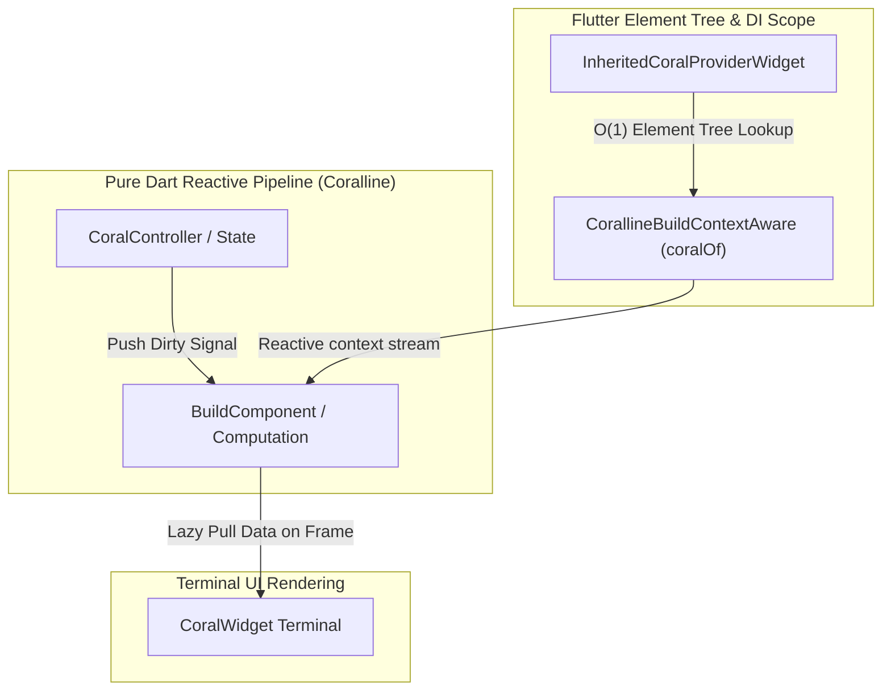
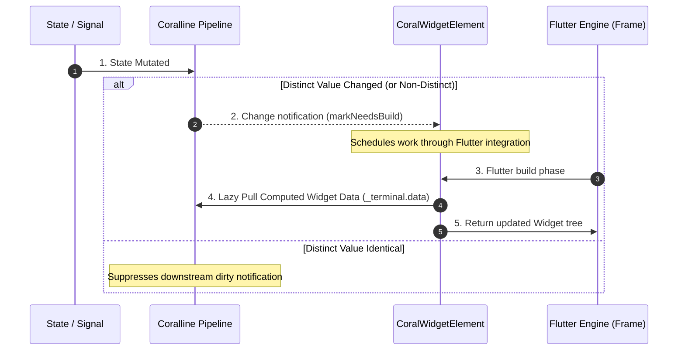

# Coralline Flutter

[](https://pub.dev/packages/coralline_flutter)
[](LICENSE)
[](https://flutter.dev)

> **"Seamlessly bridge pure Dart reactive pipelines with Flutter's element tree."**  
> *Single- and multi-dependency components, provider lookup through Flutter's widget tree, and push-dirty/pull-data integration.*

**Coralline Flutter** (`coralline_flutter`) connects Coralline's reactive pipelines to Flutter widgets. It includes components for declaring one or multiple reactive dependencies, provider widgets for scoped state access, context-aware helpers, and animation integrations. Flutter remains responsible for scheduling widget builds and rendering frames.

<br><br>

## Key Features

- **Single Dependency (`SimplexBuildComponent`)**: Declares one upstream reactive node directly instead of using an iterable manifest.
- **Multi-Dependency Reactive UI (`BuildComponent`)**: Pure, topological N:1 reactivity that updates widgets lazily only when declared upstream nodes emit dirty signals.
- **Context Access (`CorallineBuildContextAware`)**: Read values such as `Theme`, `MediaQuery`, and inherited providers through the provided context-aware APIs. Follow the lifecycle rules of the component using them.
- **Scoped Providers (`InheritedCoralProviderWidget` & `coralOf<T>()`)**: Place providers in the widget tree and access them from descendant Coralline components.
- **Animation Integrations (`ResilientAnimationController` & ticker mixins)**: Connect Flutter animation controllers to Coralline lifecycle and reactive values. Review the API lifecycle requirements when using these helpers.
- **Push-Dirty, Pull-Data**: Pipeline changes notify dependent components; derived values are read when the component evaluates them. Flutter still controls build scheduling.

<br><br>

## Getting Started

Add `coralline_flutter` to your `pubspec.yaml`:

```yaml
dependencies:
  flutter:
    sdk: flutter
  coralline: ^0.1.4
  coralline_flutter: ^0.1.6
```

Or run:

```bash
flutter pub add coralline_flutter
```

<br><br>

## Key Concepts

### 1. System Architecture & Flow Diagram

`coralline_flutter` seamlessly bridges pure Dart reactive pipelines with Flutter's element tree using a push-dirty, pull-data topology.



*(Reactive notifications connect Coralline nodes to Flutter elements.)*

### 2. Push-Dirty & Pull-Data Lazy Execution Flow

`coralline_flutter` connects reactive pipeline changes to Flutter components. A component reads its declared dependencies when it builds; Flutter decides when the build runs.



*(The component reads pipeline values during its build; frame timing is managed by Flutter.)*

### 3. Topological Manifest (`@manifestSync`)

Components declare their upstream reactive dependencies through `manifest()`. Declaring dependencies lets Coralline connect the component to the nodes it reads; it does not guarantee that no other widget rebuilds occur.

> [!NOTE]
> **Intent Firewall (Structural Intent Isolation)**
> When a reactive node is shared across components, use the documented broadcast topology. Coralline's terminal intents and graph ownership rules determine how notifications and errors are routed; see the broadcaster and terminal API docs for details.

<br><br>

## Quick Start & Usage Examples

### Example 1: 1:1 Inline Reactive Binding (`.map(...).toWidget()`)

When a UI component depends on a single reactive signal node, you can concisely bind a reactive widget inline using `.map(...)` and `.toWidget()` without creating a separate class.

```dart
import 'package:flutter/material.dart';
import 'package:coralline_flutter/coralline_flutter.dart';

void main() => runApp(CounterApp());

class CounterApp extends StatelessWidget {
  CounterApp({super.key});

  // 1. Define reactive signal state
  final counterController = CoralController<int>(0);

  @override
  Widget build(BuildContext context) {
    return MaterialApp(
      home: Scaffold(
        appBar: AppBar(title: const Text('Simplex Counter Example')),
        body: Center(
          child: counterController.provider.coral
              .map((count) => Text(
                    'Count: $count',
                    style: const TextStyle(fontSize: 28, fontWeight: FontWeight.bold),
                  ))
              .toWidget(),
        ),
        floatingActionButton: FloatingActionButton(
          onPressed: () => counterController.set(counterController.data + 1),
          child: const Icon(Icons.add),
        ),
      ),
    );
  }
}
```

### Example 2: Multi-Dependency UI with `BuildComponent` (N:1 Binding)

Use `BuildComponent` when a UI subtree depends on **multiple** reactive streams (e.g., user profile + theme setting).

```dart
base class UserHeaderCard extends BuildComponent {
  UserHeaderCard({
    required this.usernameCoral,
    required this.unreadCountCoral,
  });

  final Coral<String> usernameCoral;
  final Coral<int> unreadCountCoral;

  @override
  @manifestSync
  Iterable<CoralNode> manifest() => [usernameCoral, unreadCountCoral];

  @override
  Widget build() {
    return Card(
      child: ListTile(
        title: Text('Welcome back, ${usernameCoral.data}!'),
        trailing: Badge(
          label: Text('${unreadCountCoral.data}'),
        ),
      ),
    );
  }
}
```

### Example 3: Context-Aware Business Component (`CorallineBuildContextAware`)

Access Flutter's `BuildContext` (Theme, MediaQuery, InheritedWidgets) directly inside reactive computations without breaking purity.

```dart
base class ThemedStatusBadge extends BuildComponent
    with CorallineTerminalIntentAware, CorallineBuildContextAware {
  ThemedStatusBadge({required this.statusMessage});

  final Coral<String> statusMessage;

  // Reactively derive Theme from Flutter's BuildContext
  late final themeCoral = context.map((ctx) => Theme.of(ctx)).distinct();

  @override
  @manifestSync
  Iterable<CoralNode> manifest() => [statusMessage, themeCoral];

  @override
  Widget build() {
    final theme = themeCoral.data;
    return Container(
      padding: const EdgeInsets.all(12.0),
      color: theme.colorScheme.primaryContainer,
      child: Text(
        statusMessage.data,
        style: TextStyle(color: theme.colorScheme.onPrimaryContainer),
      ),
    );
  }
}
```

### Example 4: Dependency Injection via `InheritedCoralProviderWidget` & `coralOf<T>()`

Inject reactive state into the widget tree and read it from any descendant component without prop-drilling.

```dart
// 1. Domain model & internal reactive signals definition
class AppUser {
  AppUser(this.name);
  final String name;

  // Reactive controller pipeline for unread message count (broadcast: true for multi-subscriber UI binding)
  final unreadCountController = CoralController<int>(3, broadcast: true);
  Coral<int> get unreadCountCoral => unreadCountController.coral;

  // Reactive controller pipeline for shopping cart item count (broadcast: true for multi-subscriber UI binding)
  final cartItemCountController = CoralController<int>(5, broadcast: true);
  Coral<int> get cartItemCountCoral => cartItemCountController.coral;
}

// 2. Inject reactive state at the root of your app
Widget buildApp(CoralProvider<AppUser> userProvider) {
  return InheritedCoralProviderWidget<AppUser>(
    provider: userProvider,
    child: UserGreeting().toWidget(),
  );
}

// 3. Consume state anywhere in descendant tree and flatten inner pipelines (Cascade)
base class UserGreeting extends BuildComponent
    with CorallineTerminalIntentAware, CorallineBuildContextAware {
  // Automatically pull ancestor InheritedCoralProviderWidget state and cascade-flatten its inner pipelines
  late final userCoral = coralOf<AppUser>();
  late final unreadCountCoral = coralOf<AppUser>().cascade((user) => user.unreadCountCoral);
  late final cartItemCountCoral = coralOf<AppUser>().cascade((user) => user.cartItemCountCoral);

  @override
  @manifestSync
  Iterable<CoralNode> manifest() => [userCoral, unreadCountCoral, cartItemCountCoral];

  @override
  Widget build() {
    final user = userCoral.data;
    final unreadCount = unreadCountCoral.data;
    final cartItemCount = cartItemCountCoral.data;
    return Text('Hello, ${user.name}! (Messages: $unreadCount | Cart: $cartItemCount)');
  }
}
```

### Example 5: Resilient Animations without `StatefulWidget` (`ResilientAnimationController`)

Drive high-performance Flutter animations directly within reactive business components without `StatefulWidget` boilerplate or ticker leaks.

```dart
base class ExpandablePanel extends BuildComponent
    with
        CorallineLifecycleAware,
        CorallineTerminalIntentAware,
        CorallineBuildContextAware,
        SingleTickerProviderCorallineLifecycleAwareMixin {
  ExpandablePanel({required this.child});

  final Widget child;

  static final Animatable<double> _expansionTween = CurveTween(
    curve: Curves.easeInOut,
  );

  // 1. Initialize ResilientAnimationController using `this` as vsync TickerProvider
  late final controller = ResilientAnimationController(
    duration: const Duration(milliseconds: 300),
    vsync: this,
  );

  // 2. Drive tween animation transform
  late final animation = controller.drive(_expansionTween);

  // 3. Declare animation coral dependency in manifest
  @override
  @manifestSync
  Iterable<CoralNode> manifest() => [controller.coral];

  @override
  Widget build() {
    // 4. Render smooth animated size transition
    return SizeTransition(
      sizeFactor: animation,
      child: child,
    );
  }
}
```

### Example 6: Fault-Tolerant Pipeline Safety with `errorBuilder`

Prevent red error screens or app crashes when reactive pipelines encounter runtime exceptions (e.g. network failure, null reference, damaged state) by supplying a fallback `errorBuilder`.

```dart
class UserProfile {
  const UserProfile(this.name, this.email);
  final String name;
  final String email;
}

base class UserProfileCard extends BuildComponent {
  UserProfileCard({required this.userProfileCoral});

  final Coral<UserProfile> userProfileCoral;

  @override
  @manifestSync
  Iterable<CoralNode> manifest() => [userProfileCoral];

  @override
  Widget build() {
    // If userProfileCoral computation enters a damaged state, errorBuilder catches it
    final profile = userProfileCoral.data;
    return ListTile(
      title: Text(profile.name),
      subtitle: Text(profile.email),
    );
  }
}

// Convert to widget with an error fallback safety net
Widget buildSafeUserCard(UserProfileCard component) {
  return component.toWidget(
    errorBuilder: (context, error, stackTrace) {
      return Container(
        padding: const EdgeInsets.all(16.0),
        color: Theme.of(context).colorScheme.errorContainer,
        child: Text(
          'Failed to load user profile: $error',
          style: TextStyle(color: Theme.of(context).colorScheme.onErrorContainer),
        ),
      );
    },
  );
}
```

> **Pro Tip: App-Wide Shared Fallback Extension Pattern**  
> Create a project-specific extension (e.g. `toAppWidget()`) to encapsulate your design system's default error UI centrally across your application:

```dart
extension AppCoralWidgetExtension<T extends CoralComputation<Widget>> on T {
  CoralWidget toAppWidget({
    Key? key,
    Widget Function(BuildContext context, Object error, StackTrace? stackTrace)? errorBuilder,
  }) {
    return toWidget(
      key: key,
      errorBuilder: errorBuilder ?? (context, error, stackTrace) {
        return Container(
          padding: const EdgeInsets.all(16),
          color: Theme.of(context).colorScheme.errorContainer,
          child: Text('Error: $error'),
        );
      },
    );
  }
}
```

<br><br>

## Deep Dive: Structural Comparisons

### 1. State Management & DI: Traditional Provider vs InheritedCoralProvider

`InheritedCoralProvider` and `coralOf<T>()` provide scoped dependency injection and state access through Flutter's inherited widget mechanism. The table compares the broad integration approaches; exact rebuild and lookup behavior depends on the implementation and usage.

#### Feature Comparison Matrix (Native `InheritedWidget` vs `package:provider` vs Coralline)

| Feature | Native Flutter<br>`InheritedWidget` | Traditional<br>`package:provider` | Coralline Provider<br>(`InheritedCoralProvider` + `coralOf<T>()`) |
| :--- | :--- | :--- | :--- |
| **Execution Paradigm** | Inherited dependency notifications can mark dependents for rebuilding. | Provider APIs expose several notification and selection patterns. | Coralline notifications mark declared pipeline dependencies dirty; components read values when they build. |
| **`BuildContext` Coupling** | **Tightly Coupled to UI**<br>Must call `context.`<br>`dependOnInheritedWidgetOfExactType`<br>inside `build(context)`. | **Tightly Coupled to UI**<br>Must call `context.watch<T>()`<br>inside `Widget.build(context)`. | **Decoupled to Business Fields**<br>Declared as reactive fields in business classes via `CorallineBuildContextAware`<br>(`coralOf<T>()`). |
| **Tree & State Transitions** | Inherited dependencies follow Flutter's widget and element lifecycle. | Provider scopes follow Flutter's widget and element lifecycle. | Provider lookup uses inherited widgets; Coralline APIs can map provider changes into pipeline values. |
| **Tree Lookup Mechanics** | Uses Flutter inherited dependency lookup. | Uses Flutter inherited dependency lookup through provider APIs. | Uses `InheritedCoralProviderWidget` and Flutter's inherited dependency lookup. |

#### Illustrative update flow

The diagram is simplified. It describes one common path through each integration, not all rebuild behavior or performance characteristics.

```
[ Traditional Provider (Push-Rebuild) ]
State Update 
  └─► notifyListeners() 
        └─► InheritedElement.notifyClients() 
              └─► Element.markNeedsBuild() (Immediate Rebuild Scheduled)
                    └─► Widget.build(context) (UI Re-computation & Rendering)

[ coralline_flutter (Push-Dirty, Pull-Data Lazy Pipeline) ]
State Update 
  └─► Coralline dependency invalidation
        └─► Flutter Frame Pipeline Triggered
              └─► Terminal Pulls Computed Data Lazily
              └─► Component reads its dependencies and returns a widget
```

#### Core Advantages of `coralOf<T>()`

1. **Push-Dirty, Pull-Data**: Separates dependency invalidation from reading derived values. Flutter still determines when widget builds run.
2. **Context Access**: The context-aware APIs make selected inherited values available to Coralline components. Follow their lifecycle requirements when retaining derived nodes or context-dependent values.
3. **Automatic Cascade Stream Flattening**: `coralOf<T>()` internally evaluates:
   $$\text{coralOf<T>()} = \text{dependOn<InheritedCoralProviderWidget<T>>()}.\text{cascade}((\text{data}) \Rightarrow \text{data.provider.coral})$$
   It unifies both **ancestor widget tree transitions** and **inner state mutations** into a single, seamless `Coral<T>` stream.
4. **Declared Dependencies**: `manifest()` (`@manifestSync`) declares the component's reactive inputs so Coralline can connect and observe them.

#### Architectural Rationale: Why Inherit `InheritedWidget` & Override Rebuilds?

`coralline_flutter` does not reinvent a proprietary widget tree lookup mechanism. Instead, `InheritedCoralProviderWidget` directly extends Flutter's native `InheritedWidget` for 4 fundamental architectural reasons:

1. **Flutter Inherited Lookup**: Uses `InheritedWidget` and `dependOnInheritedWidgetOfExactType` to locate a provider and register the dependent element with Flutter.
2. **Element Lifecycle**: Flutter tracks inherited dependencies for its elements and updates those relationships as the widget tree changes. Applications still need to manage Coralline objects they create directly.
3. **Seamless Flutter Ecosystem Compatibility**: Bridges native Flutter UI context providers (`Theme`, `MediaQuery`, `Localizations`) into pure reactive `Coral<T>` nodes via `CorallineBuildContextAware`.
4. **Intuitive Scoped Dependency Injection**: Preserves familiar widget-tree-scoped DI patterns without requiring complex global container setups.

> **Summary**: `InheritedCoralProviderWidget` uses Flutter's inherited widget mechanism for scoped lookup. Coralline's pipeline then provides its own dependency and value-reading behavior.

<br><br>

### 2. Animation Engine: Traditional AnimationController vs ResilientAnimationController

`ResilientAnimationController` connects Flutter's animation controller to Coralline's reactive resource lifecycle. It offers an alternative to managing that integration directly in a `StatefulWidget`; applications should still follow the helper's lifecycle requirements.

#### Feature Comparison Matrix

| Feature | Traditional `AnimationController` | Coralline `ResilientAnimationController` |
| :--- | :--- | :--- |
| **Engine Instantiation** | **Eager (Immediate)**<br>Requires active ticker immediately upon creation. | **Lazy (On-Demand)**<br>Stays dormant until the reactive `Coral` pipeline is activated. |
| **Lifecycle & Resilience** | **Fragile State**<br>Disposing or deactivating drops state and parameters. | **State-Resilient**<br>Preserves values locally while dormant and seamlessly restores state on reactivation. |
| **Reactive Integration** | **UI Layer Only**<br>Restricted to `addListener()` or `AnimatedBuilder`. | **First-Class Reactive Node**<br>Implements `CoralProvider<double>` to pipe values directly into reactive computations. |
| **Multi-Subscriber** | **Manual Listener Handling**<br>Requires verbose listener management for multiple consumers. | **Built-in Broadcasting**<br>`broadcast: true` allows multiple subscribers to share one animation engine. |

<br><br>

### 3. Component Layer: Why `BuildComponent` Exists vs `StatelessWidget` / `StatefulWidget`

`BuildComponent` is **not** a traditional Flutter `Widget`. It is a pure Dart Coralline reactive computation node (`ComplexComputation<Widget>`) that exposes a Flutter-friendly `build()` interface.

#### Two Fundamental Reasons `BuildComponent` Exists

1. **Bridge Between Pure Dart Reactive Graphs and Flutter UI Trees**: Coralline's reactive engine operates in pure Dart. `BuildComponent` allows developers to write UI using familiar `build()` syntax while running natively inside Coralline's topological reactive graph.
2. **Declared Dependencies (`@manifestSync`)**: `BuildComponent` uses `manifest()` to declare its reactive inputs. This is a different dependency style from the usual widget build and inherited dependency patterns; it does not replace Flutter's widget lifecycle.

<br><br>

### 4. Architectural Comparison: Coralline vs BLoC vs Riverpod vs Signals

Coralline Flutter represents UI output as a reactive computation node. The table gives a high-level comparison of concepts; the libraries have different APIs and the comparison is not a benchmark:

| Feature | Coralline Flutter | BLoC | Riverpod | Signals (Preact) |
| :--- | :--- | :--- | :--- | :--- |
| **Architecture** | **Lazy-Computed DAG + MVI** | Monolithic State + MVI | Provider Graph (DAG) | Reactive Primitives |
| **Data Propagation** | **Push-Dirty, Pull-Data** | Commonly modeled with events and states | Provider invalidation and recomputation patterns vary | Push-Dirty, Pull-Data |
| **Intent Handling** | **Upstream Intent + Firewall** | Sink Event Dispatch | Notifier Direct Calls | Direct Signal Mutation |
| **Rebuild Execution** | Flutter schedules builds; components read their dependencies when building | Flutter schedules builds from BLoC state notifications | Flutter schedules builds according to provider changes | Depends on the signal and Flutter integration |
| **Safety & Control** | **Intent Firewall + `fallback` / `errorBuilder`** | Runtime Try/Catch | `AsyncValue` Catch | Exception Propagation |
| **Dynamic Hotswap** | **Native (`CoralCoupler`)** | Manual Stream Rebind | `ref.watch` Dynamic Rebind | `effect` Re-track |

#### Key Architectural Takeaways

- **Compared with BLoC**: Both can be used to manage Flutter application state. Coralline centers its API on reactive value graphs; BLoC centers its API on events and states.
- **Compared with Riverpod**: Both expose ways to connect dependencies and derive values. They differ in provider APIs, graph ownership, and lifecycle model.
- **Compared with signals libraries**: Both can represent derived reactive values. The available operators and Flutter integration depend on the particular signals package.

<br><br>


## Performance Best Practices

1. **Use `SimplexBuildComponent` for one dependency**: It declares a single upstream node directly; `BuildComponent` uses an iterable manifest for multiple inputs.
2. **Cache Derived Nodes in `late final` Fields**: Avoid calling `context.map(...)` repeatedly inside `build()` or `compute()`. Always store derived broadcaster line nodes in `late final` fields.
3. **Use `.toWidget()` Helper**: Convert your `BuildComponent` or `Coral<Widget>` into a Flutter `Widget` using `.toWidget()` for standard, fluid Flutter composition.

<br><br>

## License

Coralline Flutter is open-source software licensed under the [Apache 2.0 License](LICENSE).  
Copyright 2023-2026 Youngjune Jeon All rights reserved.
